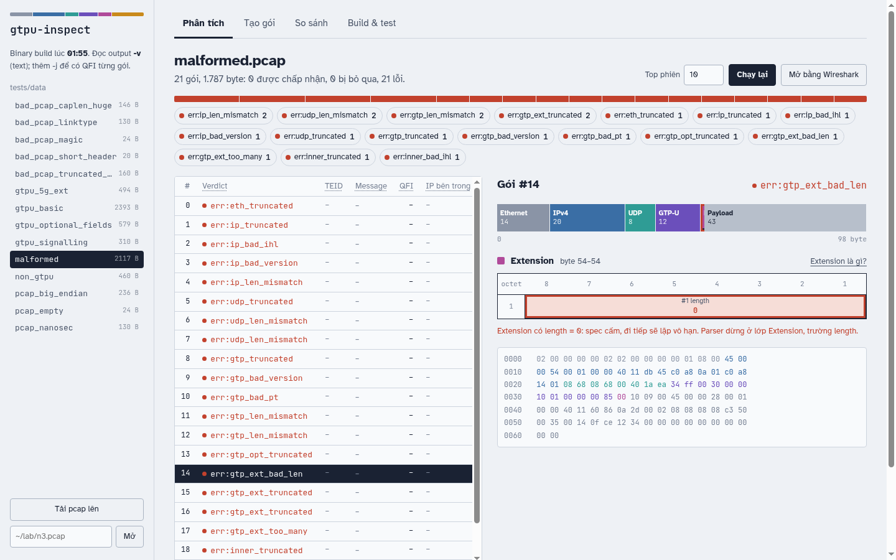
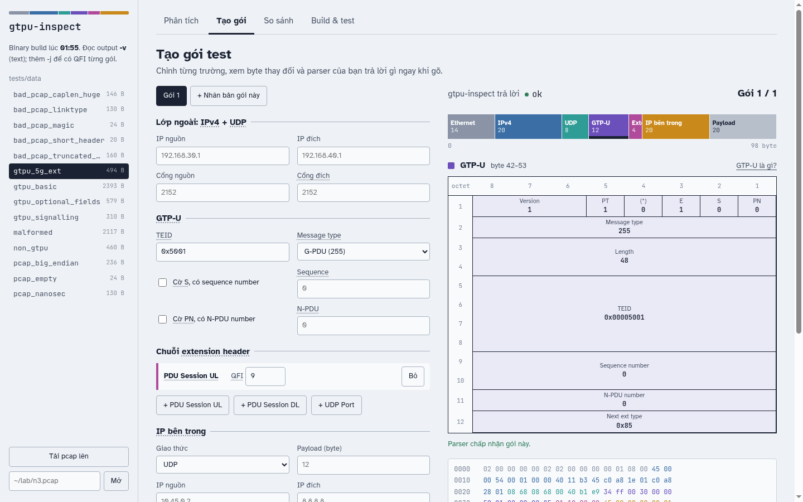
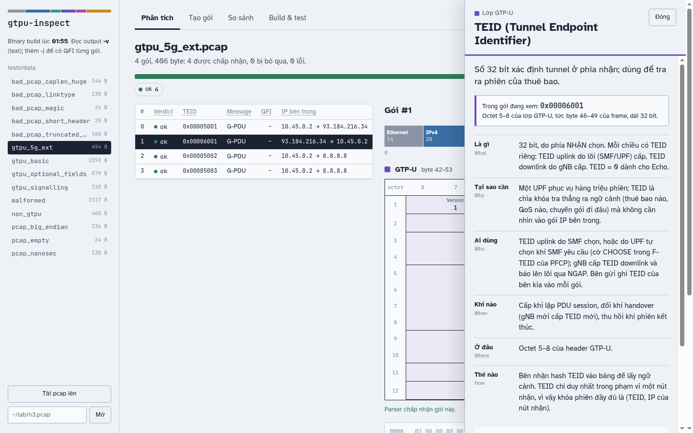
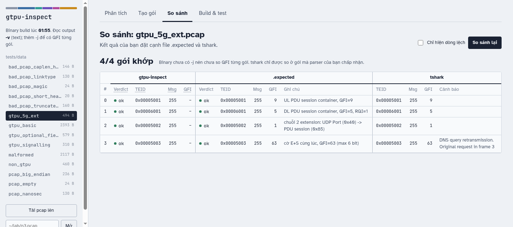
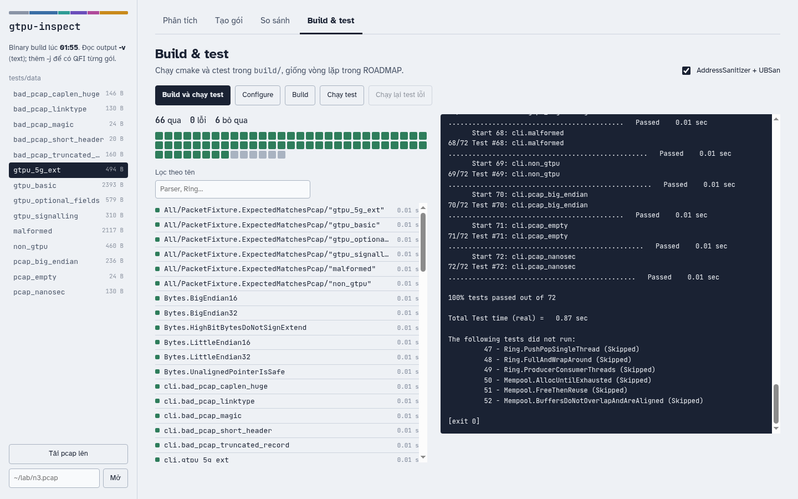

# GTPU-inspect

**English** | [Tiếng Việt](README.vi.md)

**gtpu-inspect** is a user-plane traffic analyzer for 4G/5G mobile networks, written in C11.

In LTE and 5G, user data between the radio access network (eNB/gNB) and the core
(SGW/UPF) is carried inside GTP-U tunnels over UDP port 2152, with each session
identified by a Tunnel Endpoint Identifier (TEID). This project reads raw `.pcap`
captures, decodes the Ethernet → IPv4 → UDP → GTP-U → inner IP stack according to
3GPP TS 29.281, and reports traffic statistics per tunnel session.

### Features
- Pcap file reader written from scratch (no libpcap)
- GTP-U decoding: mandatory and optional header fields, extension header chains
  (including the 5G PDU Session Container / QFI), G-PDU, Echo, Error Indication, End Marker
- Per-TEID session table (open-addressing hash table) with packet/byte counters
- Strict bounds checking: malformed packets are counted by error type, never trusted
- *(planned)* Multi-worker pipeline with TEID-based dispatch and lock-free SPSC ring buffers
- *(planned)* Fixed-size memory pool and throughput benchmarks

### Quality
- Builds with `-Wall -Wextra -Werror -std=c11` on GCC and Clang
- Unit tests (GoogleTest), AddressSanitizer/UBSan and Valgrind in CI
- Parser fuzzing with libFuzzer *(planned)*

### Motivation
During my internship in network protocol research, I analyzed traffic with Wireshark.
This project is my way of understanding what the software that processes that traffic
inside a mobile network actually does.

### Build & test
```sh
pip install -r tools/requirements.txt     # only needed to regenerate test data
cmake -B build -DGTPU_SANITIZE=ON
cmake --build build -j
ctest --test-dir build --output-on-failure
```

| CMake option | Effect |
|---|---|
| `GTPU_SANITIZE=ON` | build with AddressSanitizer + UBSan |
| `GTPU_BUILD_FUZZ=ON` | build the libFuzzer target (requires `CC=clang CXX=clang++`) |
| `GTPU_BUILD_BENCH=ON` | build programs in `bench/` |
| `GTPU_BUILD_TESTS=OFF` | skip unit tests |

### Web UI
A local web interface on top of the `gtpu-inspect` binary: open a capture, see why
each packet was accepted or rejected, craft test packets, compare against Wireshark
and run the build. Every packet is drawn as an octet grid in the style of the
3GPP header figures, and every field explains itself on hover.



#### Install
Requirements: Python 3 (tested with 3.14), CMake, GCC or Clang. Optional: `tshark` for the
Compare tab, Wireshark for the "Open in Wireshark" buttons.

```sh
python3 -m venv .venv
.venv/bin/pip install -r tools/requirements.txt -r tools/ui/requirements.txt
cmake -B build -DGTPU_SANITIZE=ON && cmake --build build -j   # the UI runs build/gtpu-inspect
```

On Arch Linux: `pacman -S cmake wireshark-qt` (also installs `tshark`).

#### Start
```sh
.venv/bin/python tools/ui/server.py              # http://127.0.0.1:8152
.venv/bin/python tools/ui/server.py --port 9000  # another port
```
The server listens on 127.0.0.1 only. Changes to the C code need a rebuild
(Build & test tab or `cmake --build build`); changes to `tools/ui/*.py` need a
server restart; changes to `tools/ui/static/` only need a page reload.

#### Use
- **Sidebar**: pick a fixture from `tests/data/`, upload a `.pcap`, or type a path
  such as `~/lab/n3.pcap`. The selected file is shared by every tab. Links like
  `/?file=tests/data/malformed.pcap&idx=14#analyze` open a file, packet and tab directly.
- **Analyze**: the verdict bar doubles as a filter. Pick a packet with the mouse or
  ↑/↓; the byte strip shows each layer at its real size, a dashed red region marks
  bytes the GTP Length field asks for but the packet does not have, and clicking a
  layer shows its octet grid. The field that stopped the parser is outlined in red.
  Hovering a field highlights its bytes in the hex dump.
- **Build packets**: edit the outer IP/UDP, GTP-U flags, extension chain, inner IP,
  or break the packet on purpose (truncate, wrong length, extension length 0…).
  The octet grid and your parser's verdict update as you type. Save to
  `build/ui/<name>.pcap`, analyze it, open it in Wireshark, or export Python code
  to paste into `tools/gen_pcaps.py` as a new fixture.
- **Compare**: your output next to the `.expected` file and `tshark`, mismatches in red.
  Click a row to open that packet in Analyze.
- **Build & test**: configure (with or without sanitizers), build and run CTest with
  live logs; failed tests can be rerun on their own.
- **Glossary**: dotted-underlined terms and every octet-grid cell show a short
  explanation on hover. Click (or Enter) opens a panel with the field's value in the
  current packet and a What / Why / Who / When / Where / How breakdown, the link to
  this project's code, and the spec reference. Esc closes it. Entries live in
  `tools/ui/static/glossary.js`.

| Build packets | Glossary |
|---|---|
|  |  |
| **Compare** | **Build & test** |
|  |  |

Until `gtpu-inspect` supports `-j`, the UI reads the `-v` text output and the
per-packet QFI column stays empty. The NDJSON format the UI expects is specified in
`docs/ui-design.md`; once the binary accepts `-j` the UI switches to it automatically.

UI tests (output parsing, packet builder, and a field-by-field check of the octet
grid against `tshark`):
```sh
.venv/bin/python -m pytest tools/ui
```

### Repository layout
```
include/, src/   core C11 (parser, GTP-U, session table, ring, mempool)
tests/           GoogleTest unit tests + data-driven tests on tests/data/*.pcap
tests/data/      generated pcaps, each with a .expected file (per-packet verdict)
tools/           gen_pcaps.py (Scapy), make_corpus.py, tshark_dump.sh
tools/ui/        local web UI: inspect packets, craft test packets, compare, build & test
fuzz/            libFuzzer target
bench/           benchmark notes and programs
docs/ROADMAP.md  week-by-week plan and checklist
docs/5g-6g/      5G/6G study notes linked to the code
```
